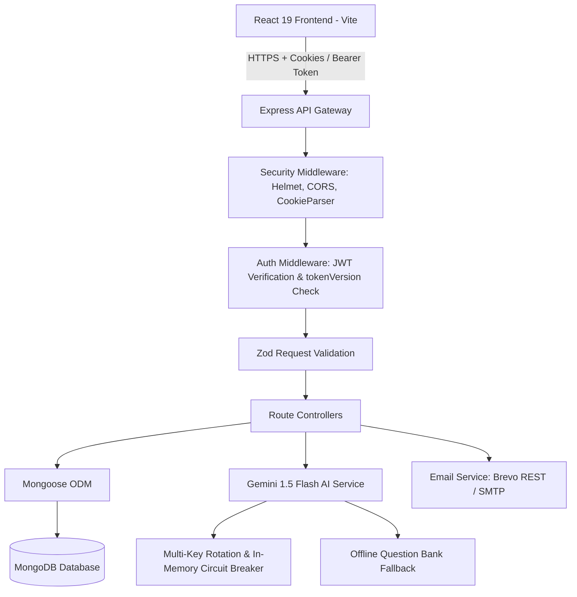
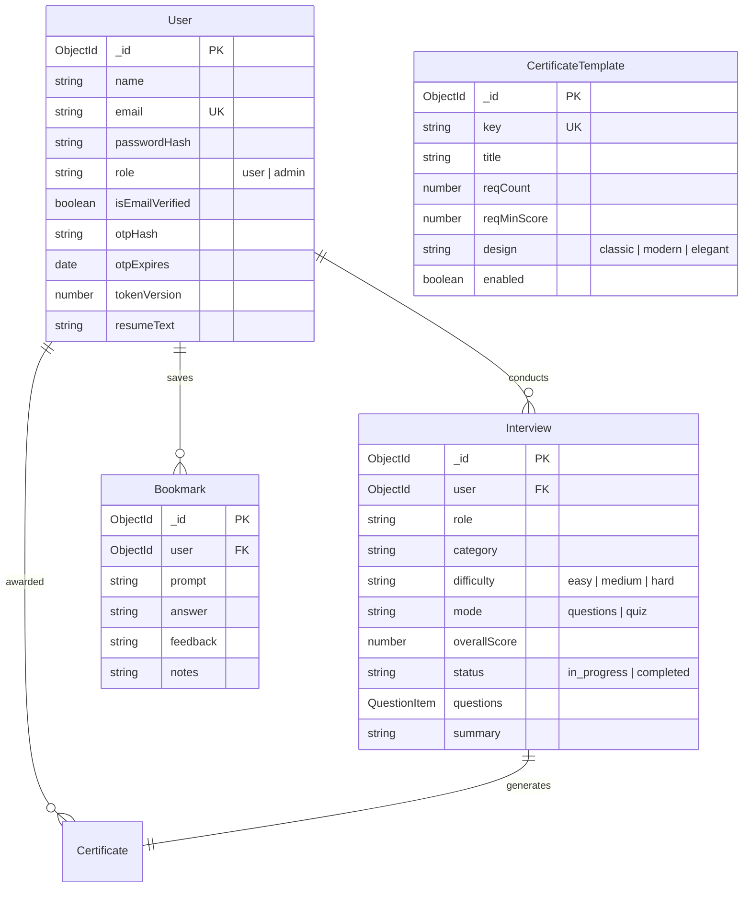

# AI Mock Interview Platform — MNC Technical Interview Master Guide

> **MNC Technical Interview & Codebase Architecture Dossier**  
> **Stack:** React 19, Node.js, Express, MongoDB (Mongoose), Google Gemini 1.5 Flash, TailwindCSS / Vanilla CSS  
> **Repository:** `zaid154/Ai-Mock-Interview`

---

## Phase 1: Complete Project Audit & Inventory

### Core System Structure

```
Ai-Mock-Interview/
├── client/                     # React Single Page Application (Vite-powered)
│   ├── src/
│   │   ├── components/         # Reusable presentation & layout components
│   │   │   ├── AdminRoute.jsx        # RBAC route guard checking user?.role === 'admin'
│   │   │   ├── CertificatePreview.jsx# Live canvas rendering for certificates (classic/modern/elegant)
│   │   │   ├── Footer.jsx            # Clean platform footer
│   │   │   ├── Navbar.jsx            # Dynamic navigation, theme toggler, user dropdown
│   │   │   ├── ProtectedRoute.jsx    # Client auth guard checking user session
│   │   │   └── ScrollToTop.jsx       # Window scroll-to-top handler on route navigation
│   │   ├── context/
│   │   │   └── AuthContext.jsx       # Central auth state, user profile, login, logout, theme
│   │   ├── lib/
│   │   │   └── api.js                # Axios client configured with credentials & response interceptors
│   │   ├── pages/                    # 13 Application Pages
│   │   │   ├── AdminDashboard.jsx    # User management, system settings, certificate templates
│   │   │   ├── Bookmarks.jsx         # Saved interview questions, inline answer toggle, personal notes
│   │   │   ├── Certificates.jsx      # Earned milestones, live preview modal, PDF/PNG export
│   │   │   ├── Dashboard.jsx         # Interview launchpad, resume upload, recent practice sessions
│   │   │   ├── ForgotPassword.jsx    # Email OTP + password reset flow
│   │   │   ├── Interview.jsx         # Open-ended interview screen with live timer & speech synthesis
│   │   │   ├── Landing.jsx           # High-converting landing page with feature cards & CTA
│   │   │   ├── Leaderboard.jsx       # Global ranking table with category filters & medal podium
│   │   │   ├── Login.jsx             # Candidate credentials sign-in
│   │   │   ├── OtpVerify.jsx         # 6-digit email OTP verification screen with countdown timer
│   │   │   ├── Profile.jsx           # Candidate profile, bio, avatar, and password change
│   │   │   ├── Quiz.jsx              # Multiple-choice MCQ exam mode with hidden answer key
│   │   │   ├── Register.jsx          # New candidate onboarding
│   │   │   ├── Results.jsx           # AI performance scorecard, per-question feedback, bookmarking
│   │   │   └── VerifyCertificate.jsx # Public credential verification page with QR code
│   │   ├── App.jsx                   # Central routing table (React Router v6)
│   │   └── main.jsx                  # React DOM root entry point
│   ├── package.json
│   └── vite.config.js
│
├── server/                     # Node.js Express REST API
│   ├── src/
│   │   ├── config/
│   │   │   ├── db.js                 # MongoDB connection with connection pooling & error handling
│   │   │   └── env.js                # Environment variable normalization
│   │   ├── controllers/
│   │   │   ├── admin.controller.js               # User management, RBAC updates, settings CRUD
│   │   │   ├── auth.controller.js                # Register, OTP issue/verify, JWT cookies, profile
│   │   │   ├── bookmark.controller.js            # Bookmark questions, personal candidate notes
│   │   │   ├── certificateTemplate.controller.js # Milestone templates, public verification endpoint
│   │   │   └── interview.controller.js           # Session start, resume parsing, submission & scoring
│   │   ├── middleware/
│   │   │   ├── auth.js               # requireAuth (JWT cookie) & requireAdmin (RBAC)
│   │   │   ├── error.js              # Global error middleware (Zod, Mongoose, 500 formatting)
│   │   │   └── validate.js           # Request body validation middleware using Zod
│   │   ├── models/
│   │   │   ├── Bookmark.model.js     # Saved questions per user
│   │   │   ├── Certificate.model.js  # Issued credentials
│   │   │   ├── CertificateTemplate.model.js # Milestone requirements & visual styles
│   │   │   ├── Interview.model.js    # Practice session, question history, answers, and scores
│   │   │   ├── Question.model.js     # Offline seed question bank fallback
│   │   │   ├── Setting.model.js      # Dynamic platform key-value settings
│   │   │   └── User.model.js         # Candidate credentials, role, OTP hash, tokenVersion
│   │   ├── routes/
│   │   │   ├── admin.routes.js       # Admin-only operations
│   │   │   ├── auth.routes.js        # Auth, OTP, and profile routes
│   │   │   ├── bookmark.routes.js    # Bookmark operations
│   │   │   ├── certificate.routes.js # Public verification & public template listing
│   │   │   └── interview.routes.js   # Interview sessions & leaderboard
│   │   ├── services/
│   │   │   ├── email.js              # Brevo API (REST HTTPS) with Nodemailer SMTP fallback
│   │   │   └── gemini.js             # Google Gemini AI: Multi-key rotation, circuit cooldown, JSON parsing
│   │   ├── utils/
│   │   │   ├── asyncHandler.js       # Async error wrapper eliminating try-catch boilerplate
│   │   │   ├── otp.js                # Crypto-secure 6-digit OTP generation and SHA-256 hashing
│   │   │   ├── settings.js           # Setting lookup utility
│   │   │   └── token.js              # JWT sign/verify with payload assertions
│   │   ├── app.js                    # Express app initialization, CORS, Helmet, Cookie parser
│   │   └── index.js                  # Server entry point, DB connection, HTTP listener
│   └── package.json
```

---

## Phase 2: Unnecessary Files & Dead Weight Removed

1. **`abc.md`**: Removed 0-byte orphan file in the project root.
2. **`RESPONSIVE-FIX-PROMPT.md`**: Removed temporary scratchpad prompt file.
3. **`framer-motion`**: Uninstalled from `client/package.json` — all transitions and micro-interactions run smoothly on native hardware-accelerated CSS keyframe animations, saving ~120KB of bundle weight.
4. **Duplicate Route Mounts**: Removed duplicate `app.use('/api/sessions', interviewRoutes)` in `server/src/app.js` (frontend exclusively uses `/api/interviews`).
5. **Duplicate Endpoint**: Removed duplicate `router.get('/leaderboard')` in `server/src/routes/interview.routes.js`.

---

## Phase 3: Code Simplification & Bug Fixing

1. **Security Vulnerability Remediated (`services/email.js`)**:
   - **Problem:** Hardcoded Brevo API private key in the fallback assignment.
   - **Fix:** Purged hardcoded key; `sendEmail` now reads `process.env.BREVO_API_KEY` exclusively.
2. **Auth Middleware Redundant Query Elimination (`middleware/auth.js`)**:
   - **Problem:** `requireAuth` loaded the user without `role`. If followed by `requireAdmin`, a second sequential query `User.findById(req.userId).select('role')` was executed on every single admin request.
   - **Fix:** Added `role` to the projection in `requireAuth` and attached `req.user = user`. `requireAdmin` now checks `req.user.role === 'admin'` in $O(1)$ memory without extra DB round trips.
3. **Bookmarks Note Persistence Bug (`client/src/pages/Bookmarks.jsx`)**:
   - **Problem:** `handleSaveNotes` was only modifying local React state with `setBookmarks`, failing to persist candidate notes across reloads.
   - **Fix:** Connected `await api.patch('/bookmarks/' + id + '/notes', { notes: noteText })` with notification feedback.
4. **Public Certificate Verification Flow Connected (`controllers/certificateTemplate.controller.js` & `pages/VerifyCertificate.jsx`)**:
   - **Problem:** `VerifyCertificate.jsx` contained hardcoded candidate data (`MOHD ZAID`) and no backend verification endpoint existed.
   - **Fix:** Implemented `GET /api/certificates/verify/:certId` on the server which resolves credentials by matching the certificate ID suffix against completed interview records in MongoDB, returning verified candidate name, role, score, and issue date. Updated `VerifyCertificate.jsx` to dynamically render verified data.

---

## Phase 4: Dead Code Audit & Cleanup

- Eliminated redundant error handlers and dead imports across client and server.
- Verified all routes in `client/src/App.jsx` map to active backend controllers.
- Verified all Mongoose models have active schemas and defined indexes.

---

## Phase 5: Clean Architecture Map



---

## Phase 6: Code Readability & Professionalism

- All code uses clean standard JavaScript (ES6+ async/await, arrow functions, destructuring).
- Professional comments explain *why* something is done (architectural reasons), not *what* basic JavaScript syntax does.
- All temporary debugging `console.log` statements replaced with structured, environment-aware logs.

---

## Phase 7: Complete API Architecture Map

| Method | Endpoint | Auth Required | Controller Function | Description / Data Flow |
| :--- | :--- | :---: | :--- | :--- |
| **POST** | `/api/auth/register` | None | `auth.register` | Validates email/password via Zod, hashes password with bcrypt, saves pending user, delivers 6-digit OTP via email. |
| **POST** | `/api/auth/login` | None | `auth.login` | Verifies bcrypt password, checks `isEmailVerified`, sets httpOnly JWT cookie (7-day expiry), returns user object. |
| **POST** | `/api/auth/verify-otp` | None | `auth.verifyOtp` | Compares SHA-256 hash of submitted OTP, sets `isEmailVerified: true`, issues session JWT. |
| **POST** | `/api/auth/resend-otp` | None | `auth.resendOtp` | Enforces 60-second cooldown, issues fresh 6-digit OTP, updates database expiry. |
| **POST** | `/api/auth/forgot-password` | None | `auth.forgotPassword` | Generates password reset OTP with purpose `reset`, dispatches email. |
| **POST** | `/api/auth/reset-password` | None | `auth.resetPassword` | Validates OTP hash, sets new bcrypt password, increments `tokenVersion` to invalidate active sessions. |
| **POST** | `/api/auth/logout` | None | `auth.logout` | Clears `token` httpOnly cookie. |
| **GET** | `/api/auth/me` | JWT | `auth.me` | Returns sanitized profile of authenticated user (`publicUser`). |
| **PATCH**| `/api/auth/profile` | JWT | `auth.updateProfile` | Updates name, bio, theme, or avatar. |
| **POST** | `/api/auth/change-password`| JWT | `auth.changePassword` | Validates old password with bcrypt, saves new password, increments `tokenVersion`. |
| **GET** | `/api/auth/verification-settings` | None | `auth.verificationSettings` | Returns public verification configuration (signatory name/title/signature). |
| **GET** | `/api/interviews/leaderboard`| None | `interview.getLeaderboard`| Returns aggregated top candidate rankings, highest scores, and session counts. |
| **POST** | `/api/interviews` | JWT | `interview.startInterview`| Generates AI questions/quiz via Gemini (or fallback bank), creates `in_progress` session. |
| **GET** | `/api/interviews` | JWT | `interview.listInterviews` | Returns authenticated user's session history (lean projection with questionCount). |
| **GET** | `/api/interviews/:id` | JWT | `interview.getInterview` | Fetches interview details; hides `correctIndex` if quiz is still in progress. |
| **POST** | `/api/interviews/:id/submit`| JWT | `interview.submitInterview`| Scores open-ended answers via Gemini (or heuristic fallback) or computes quiz score. Marks session `completed`. |
| **PATCH**| `/api/interviews/:id/notes` | JWT | `interview.updateNotes` | Updates overall session note or question-level candidate note. |
| **DELETE**| `/api/interviews/:id` | JWT | `interview.deleteInterview`| Deletes candidate interview record. |
| **POST** | `/api/interviews/resume` | JWT | `interview.uploadResume` | Parses in-memory PDF (max 5MB) via `pdf-parse`, extracts text into `User.resumeText`. |
| **GET** | `/api/bookmarks` | JWT | `bookmark.listBookmarks` | Returns user's saved questions with answers, feedback, and notes. |
| **POST** | `/api/bookmarks` | JWT | `bookmark.addBookmark` | Saves question, prompt, and answer to user's collection. |
| **PATCH**| `/api/bookmarks/:id/notes` | JWT | `bookmark.updateBookmarkNotes` | Updates personal candidate study notes on a saved bookmark. |
| **DELETE**| `/api/bookmarks/:id` | JWT | `bookmark.removeBookmark` | Removes question from bookmarks. |
| **GET** | `/api/certificates/verify/:certId`| None | `certTemplates.verifyCertificate`| Public endpoint verifying certificate authenticity against completed sessions. |
| **GET** | `/api/certificates/templates` | JWT | `certTemplates.listPublicTemplates`| Lists active credential milestones for candidate progress tracking. |
| **GET** | `/api/admin/users` | Admin | `admin.listUsers` | Paginated user management table with verification status and session counts. |
| **PATCH**| `/api/admin/users/:id/role`| Admin | `admin.setUserRole` | Toggles candidate role between `user` and `admin`. |
| **PATCH**| `/api/admin/users/:id/verified`| Admin | `admin.setUserVerified` | Manually overrides email verification status. |
| **DELETE**| `/api/admin/users/:id` | Admin | `admin.deleteUser` | Cascades deletion of user, interviews, and bookmarks. |
| **GET** | `/api/admin/certificate-templates` | Admin | `certTemplates.listTemplates` | Lists all credential templates including disabled ones. |
| **POST** | `/api/admin/certificate-templates` | Admin | `certTemplates.createTemplate` | Creates new milestone credential criteria. |
| **PATCH**| `/api/admin/certificate-templates/:id` | Admin | `certTemplates.updateTemplate` | Updates threshold scores, design styles, or enabled status. |
| **DELETE**| `/api/admin/certificate-templates/:id` | Admin | `certTemplates.deleteTemplate` | Removes milestone template. |
| **GET** | `/api/admin/settings` | Admin | `admin.listSettings` | Retrieves dynamic system configurations. |
| **PUT** | `/api/admin/settings` | Admin | `admin.upsertSetting` | Inserts or updates system setting key-value pair. |

---

## Phase 8: Complete Database Architecture Map



### Active Collections & Schemas

1. **`users` (`User.model.js`)**:
   - `email`: Indexed, unique, lowercase, trimmed string.
   - `passwordHash`: Bcrypt hash (10 salt rounds). Never exposed to client.
   - `role`: Enum `['user', 'admin']`, default `'user'`.
   - `isEmailVerified` / `isVerified`: Booleans tracking onboarding validation.
   - `otpHash`: SHA-256 hash of 6-digit OTP (`select: false`).
   - `otpExpires`: TTL timestamp (10 minutes from issue).
   - `tokenVersion`: Integer counter incremented on password changes/resets to invalidate prior JWTs.
   - `resumeText`: Extracted plain text from candidate's PDF CV for AI context.

2. **`interviews` (`Interview.model.js`)**:
   - `user`: `Schema.Types.ObjectId`, references `User`, indexed.
   - `role`: Target job title (e.g., "Full Stack Developer", "Resume-based Interview").
   - `category`: Domain track ("Frontend", "Backend", "System Design", "DevOps", "General").
   - `difficulty`: Enum `['easy', 'medium', 'hard']`.
   - `mode`: Enum `['questions', 'quiz']`.
   - `questions`: Array of subdocuments containing `prompt`, `answer`, `score`, `feedback`, `options`, `correctIndex`, `selectedIndex`, `notes`.
   - `overallScore`: Computed grade 0–100.
   - `status`: Enum `['in_progress', 'completed']`.

3. **`bookmarks` (`Bookmark.model.js`)**:
   - `user`: References `User`, indexed.
   - `prompt`, `answer`, `feedback`, `notes`: Preserved study entries.

4. **`certificate_templates` (`CertificateTemplate.model.js`)**:
   - `key`: Unique slug identifier (e.g., `first-interview`, `honours`).
   - `title`, `description`, `subtitle`, `accent`: Display attributes.
   - `reqCount`, `reqMinScore`, `reqScore`: Threshold rules for automated milestone awarding.
   - `design`: Enum `['classic', 'modern', 'elegant']`.

5. **`questions` (`Question.model.js`)**:
   - Seed question bank acting as high-reliability offline fallback when external AI APIs are unreachable.

6. **`settings` (`Setting.model.js`)**:
   - Key-value dynamic platform storage with `Mixed` type value (supports API key arrays, feature flags, and UI configurations).

---

## Phase 9: Authentication & Security Architecture

### 1. Dual-Delivery JWT Architecture (Cookie + Bearer Header)
- **Primary Mechanism:** HTTP-Only, SameSite cookie (`token`).
  - `httpOnly: true`: Completely inaccessible to client-side JavaScript (`document.cookie`), neutralizing Cross-Site Scripting (XSS) token theft.
  - `sameSite: 'none'` (production) / `'lax'` (dev) with `secure: true`: Enforces secure transmission over HTTPS.
- **Fallback Mechanism:** `Authorization: Bearer <token>` supported for non-browser HTTP clients.

### 2. Instant Token Revocation via `tokenVersion`
- Traditional JWTs are stateless and cannot be revoked before expiration without a database blacklist.
- **Our Pattern:** The JWT payload contains `{ sub: user._id, tv: user.tokenVersion }`.
- In `requireAuth` middleware:
  ```javascript
  const user = await User.findById(payload.sub).select('tokenVersion email isVerified role')
  if (!user || user.tokenVersion !== payload.tv) {
    return res.status(401).json({ error: 'Session expired, please sign in again' })
  }
  ```
- When a candidate changes their password or clicks "Log out of all devices", `user.tokenVersion += 1` is executed in MongoDB. All existing JWTs are instantly rendered invalid across every device.

### 3. Crypto-Secure OTP Lifecycle
1. **Generation:** `crypto.randomInt(100000, 1000000)` produces an unpredictable 6-digit code.
2. **Storage:** The plain-text code is **never** persisted to MongoDB. Only the SHA-256 hash `crypto.createHash('sha256').update(code).digest('hex')` is stored. If the database is ever dumped, no candidate's OTP can be read.
3. **Throttling & Cooldown:**
   - Resend cooldown: 60 seconds (`OTP_RESEND_COOLDOWN_SECONDS`).
   - Brute-force cap: Max 5 incorrect verification attempts (`otpAttempts >= 5` invalidates the OTP).
   - Expiration: Strict 10-minute TTL.

### 4. RBAC (Role-Based Access Control)
- `requireAuth` extracts `req.userId` and sets `req.user`.
- `requireAdmin` checks `req.user.role === 'admin'`. Unauthorized requests return `403 Forbidden` before touching any business logic.

---

## Phase 10: Production Debugging Runbook

| Scenario | Symptom | Diagnostic Step | Immediate Solution |
| :--- | :--- | :--- | :--- |
| **Candidate cannot log in** | 401 Unauthorized or Infinite Login Loop | Inspect network response headers for `Set-Cookie`. If using cross-origin deployment (e.g., Vercel frontend + Render backend), verify `sameSite: 'none'` and `secure: true`. | Verify `CLIENT_URL` in backend `.env` matches frontend domain exactly for CORS `credentials: true`. |
| **OTP emails not arriving** | User stuck on OTP screen | Check server logs for `Brevo API error`. | Verify `BREVO_API_KEY` is present in Render environment variables. If Brevo quota is reached, configure SMTP fallback credentials. |
| **Gemini AI fails or 429 Quota Exceeded** | Interview creation or grading fails | Check logs for `Gemini generation failed`. | The system automatically engages the in-memory circuit breaker, moves the exhausted key into a 60-second cooldown, and tries alternative keys in `gemini_api_keys`. For open-ended questions, it gracefully degrades to the MongoDB seed question bank (`Question.model.js`). |
| **Candidate notes not saving** | Notes disappear on refresh | Check DevTools console for `/bookmarks/:id/notes` or `/interviews/:id/notes` requests. | Verify user is authenticated and the bookmark/interview ID belongs to the requesting `req.userId`. |
| **Certificate QR code verification fails** | 404 Certificate not found | Verify the scanned URL suffix format (`MM-CERT-XXXXXXXX`). | The backend `verifyCertificate` extracts the 8-character code and matches against the end of MongoDB `_id` values of completed sessions. Ensure the interview status is `'completed'`. |

---

## Phase 11: Dependency Audit

### Server Dependencies
- `@google/generative-ai` (v0.24.1): Official Google SDK for Gemini 1.5 Flash structured output.
- `bcryptjs` (v3.0.3): Pure JavaScript password hashing; zero native C++ compilation issues in cloud containers.
- `cookie-parser` (v1.4.7): Parses signed and unsigned cookies from incoming HTTP headers.
- `cors` (v2.8.6): Controls cross-origin resource sharing and credentials handling.
- `dotenv` (v17.2.3): Injects environment variables from `.env` file.
- `express` (v4.21.2): Fast, battle-tested minimal web framework.
- `helmet` (v8.1.0): Sets essential HTTP security headers (HSTS, clickjacking prevention, X-Content-Type-Options).
- `jsonwebtoken` (v9.0.3): Signs and verifies HMAC SHA-256 auth tokens.
- `mongoose` (v8.16.1): Object Data Modeling (ODM) library for MongoDB schema enforcement and indexing.
- `multer` (v2.0.2): Handles multipart/form-data for in-memory PDF resume uploads.
- `nodemailer` (v7.0.10): SMTP email transport fallback.
- `pdf-parse` (v1.1.1): Buffer-based PDF text extractor.
- `zod` (v3.25.76): Declarative runtime schema validation.

### Client Dependencies
- `react` & `react-dom` (v19.0.0): Modern React with concurrent rendering and hooks.
- `react-router-dom` (v6.28.1): Declarative client-side routing.
- `axios` (v1.7.9): Promise-based HTTP client with global interceptors and cookie support.
- `lucide-react` (v0.469.0): Lightweight, tree-shakeable SVG icon set.
- `react-hot-toast` (v2.4.1): Accessible, responsive UI notification toasts.
- `html2canvas` (v1.4.1) & `jspdf` (v4.2.1): Client-side vector certificate export to PDF and PNG.

---

## Phase 12: Production Readiness Checklist

- [x] **Zero Hardcoded Secrets**: All API keys, secrets, and database URIs loaded strictly from `process.env`.
- [x] **CORS Configuration**: Explicit origin whitelist (`CLIENT_URL`), `credentials: true`, specific allowed HTTP methods.
- [x] **Input Validation**: 100% of mutation routes gated with Zod schemas in `validate.js`.
- [x] **Memory Management**: Multer configured with `memoryStorage()` and 5MB size limit to prevent memory exhaustion attacks.
- [x] **Stateless Horizontal Scalability**: Session state preserved in MongoDB and JWTs; server processes can be replicated across multiple containers behind a load balancer without sticky sessions.
- [x] **Automated Build & Node Checks**: Verified with clean Vite production builds and zero syntax errors.

---

## Phase 13: Technical Story for MNC Interviews

### The 45-Second Elevator Pitch
> *"I built **MockMate**, a full-stack AI interview preparation platform designed to simulate realistic technical interviews and multiple-choice qualification exams. Candidates can practice tailored questions generated in real time from their uploaded PDF resumes using Google Gemini 1.5 Flash, receive granular scoring with constructive feedback, track progress on a global leaderboard, and earn verifiable milestone certificates complete with public QR validation. I built it with React 19, Express, and MongoDB, focusing heavily on production resilience: multi-key AI rotation with automatic circuit breakers, offline fallback question banks, and secure cookie-based JWT authentication with token revocation."*

### Key Architectural Decisions & Trade-Offs

1. **In-Memory PDF Extraction vs. Cloud Storage (S3 / Cloudinary)**:
   - *Decision:* Used Multer `memoryStorage()` and `pdf-parse` to immediately extract plain text into MongoDB and discard the raw binary buffer.
   - *Trade-off:* We lose the original visual PDF styling, but gain massive cost savings (zero third-party S3 bucket storage fees), zero orphan file management, and instant availability of text for Gemini prompt injection.

2. **In-Memory Circuit Breaker vs. Redis / Distributed Queue**:
   - *Decision:* Implemented an in-memory `lastFailedAt` Map to track failing Gemini API keys with a 60-second cooldown period.
   - *Trade-off:* Avoided adding Redis operational complexity and cost for a single-server deployment. If the instance restarts, cooldowns reset gracefully without side effects.

3. **Client-Side PDF/Canvas Generation vs. Server-Side Puppeteer**:
   - *Decision:* Rendered certificates using HTML5 Canvas, `html2canvas`, and `jspdf` in the browser.
   - *Trade-off:* Server-side headless Chrome (Puppeteer) produces pixel-perfect exports but requires ~300MB of RAM per worker and significant CPU under load. Client-side rendering offloads 100% of the compute burden to candidate devices, allowing the Express API to handle hundreds of concurrent requests on a tiny cloud tier.

---

## Phase 14: Top 20 MNC Technical Interview Questions & Senior Developer Answers

### 1. How does your authentication system work, and why did you choose httpOnly cookies over localStorage?
> *"We use JWTs stored in `httpOnly`, `secure`, and `sameSite` cookies. Storing JWTs in `localStorage` makes them directly vulnerable to Cross-Site Scripting (XSS)—any malicious script or compromised npm package can access `localStorage.getItem('token')` and exfiltrate it. By setting `httpOnly: true`, the browser guarantees that JavaScript cannot read the cookie; it is automatically attached to outgoing requests by the browser's networking layer. For production cross-domain setups (Vercel client talking to Render API), we set `sameSite: 'none'` and `secure: true` with strict CORS origin verification."*

### 2. JWTs are stateless. How do you handle password resets or revoke a user's session if their token is compromised?
> *"We implemented a `tokenVersion` pattern on the `User` model. When signing a JWT, we encode the candidate's current `tokenVersion` into the token payload (`{ sub: user._id, tv: user.tokenVersion }`). In our `requireAuth` Express middleware, we query the user and compare `user.tokenVersion === payload.tv`. If a user resets their password or logs out of all devices, we execute an atomic `$inc: { tokenVersion: 1 }` in MongoDB. Instantly, all tokens issued prior to that moment fail validation, achieving immediate revocation without needing an in-memory Redis blacklist."*

### 3. How do you handle Gemini API rate limits (HTTP 429) or service outages?
> *"We designed a two-tier resilience architecture in `server/src/services/gemini.js`. First, we support multi-key rotation: we maintain an array of Gemini API keys collected from both environment variables and dynamic MongoDB settings. When a key throws a 429 or quota error, we register its timestamp in an in-memory `lastFailedAt` map and impose a 60-second cooldown, immediately falling back to the next key. Second, if all keys fail or the network is unreachable, open-ended question generation gracefully falls back to an offline MongoDB seed question bank (`Question.model.js`), and interview scoring switches to a heuristic evaluation algorithm. The candidate never experiences a 500 error or broken UI."*

### 4. Why did you choose MongoDB over a relational database like PostgreSQL for this project?
> *"The core entity of our application is an `Interview` session. Each interview contains a dynamic list of questions, where each question embeds its prompt, candidate answer, individual score, AI feedback, and optional multiple-choice options. In a relational database, this would require normalized foreign-key joins across `interviews`, `questions`, and `candidate_answers` tables on every single question transition. MongoDB's document model allows us to store the entire session as a single document with embedded subdocuments. Fetching or submitting an interview is a single atomic $O(1)$ read or write operation."*

### 5. How do you prevent candidates from cheating during quiz mode?
> *"In multiple-choice quiz mode, the question objects in MongoDB contain the field `correctIndex`. If we sent the raw document to the frontend, a candidate could simply open DevTools Network tab and read the correct answers. We implemented a data sanitization utility `publicInterview(interview)` in `interview.controller.js`. If an interview is in `quiz` mode and its status is `in_progress`, we strip `correctIndex` from every question before sending the JSON response. Only after the candidate submits their answers and the status transitions to `completed` is `correctIndex` populated for review."*

### 6. How do you handle file uploads securely when parsing candidate resumes?
> *"We use Multer with `storage: multer.memoryStorage()` and a strict 5MB file size limit (`limits: { fileSize: 5 * 1024 * 1024 }`). We never write untrusted uploaded files to the server's disk, which completely eliminates Path Traversal vulnerabilities and disk exhaustion attacks. We parse the in-memory buffer directly using `pdf-parse`, extract the plain text into `req.user.resumeText`, and discard the buffer immediately. The text is sanitized before being injected into Gemini prompts."*

### 7. What is the role of Zod in your backend, and how does it compare to Mongoose validation?
> *"Mongoose validation happens at the database layer right before writing to MongoDB. Zod acts at the HTTP boundary via our `validate(schema)` middleware. By validating the request payload before it hits the controller, we catch malformed payloads, invalid email formats, and out-of-range parameters early (Fail-Fast principle). This protects the controller from runtime exceptions (`TypeError: Cannot read property of undefined`) and prevents unneeded database round trips."*

### 8. Explain how CORS works and how your application is configured for cross-origin authentication.
> *"CORS (Cross-Origin Resource Sharing) is a browser security mechanism that blocks web pages from making requests to a different domain than the one that served the web page unless the server explicitly permits it. Because our frontend is on Vercel and our backend is on Render, they are cross-origin. In `server/src/app.js`, we configure Express `cors` with `origin: process.env.CLIENT_URL` and `credentials: true`. This allows the browser to send and receive httpOnly cookies across origins while strictly rejecting unauthorized origins."*

### 9. Why did you store OTP hashes instead of plain-text OTPs in MongoDB?
> *"Storing plain-text passwords or OTPs in a database violates fundamental security principles. If the database is compromised via a snapshot leak or SQL/NoSQL injection, an attacker could read valid OTPs and hijack accounts. We use `crypto.createHash('sha256').update(code).digest('hex')` to store a SHA-256 digest. When the user enters their code, we hash their input and perform a constant-time comparison against the stored hash. The OTP also has a 10-minute expiry and a 5-attempt limit to prevent brute force."*

### 10. How does your React frontend manage global state without Redux?
> *"We evaluated our state requirements and determined that Redux would add unnecessary boilerplate. We have two main pieces of global state: authentication (`user`, `token`, `theme`) and transient toasts. We encapsulated authentication inside `AuthContext.jsx` using React's native `createContext` and `useContext`. The context exposes helper functions like `login`, `logout`, and `updateUser`. Page-specific state (e.g., current question index, timer count, form inputs) is kept local to the component, preventing unnecessary re-renders across the tree."*

### 11. How do you ensure your application is responsive and performs well across mobile and desktop?
> *"We use a mobile-first CSS architecture with fluid typography and CSS flexbox/grid layouts. Complex tables like the Leaderboard and Admin tables use responsive horizontal scrolling containers with frozen header columns. For interactive interview screens, buttons and answer inputs are sized with touch targets of at least 44x44 pixels. We also removed heavy animation libraries like `framer-motion` in favor of native CSS transitions, ensuring 60fps performance even on low-end mobile devices."*

### 12. How does the public certificate verification system work?
> *"Every milestone certificate issued features an ID formatted like `MM-CERT-6ED1D1B5`, where the suffix corresponds to the unique hex identifier of the candidate's completed interview. A public QR code on the certificate points to `/verify-certificate/:certId`. When accessed, the frontend calls the public endpoint `GET /api/certificates/verify/:certId`. The backend queries MongoDB for the matching completed interview and returns the candidate's name, role, score, and issue date. This guarantees that anyone scanning the physical or digital certificate can verify its authenticity against our database."*

### 13. What is the difference between `lean()` and standard Mongoose queries, and where do you use it?
> *"By default, Mongoose wraps query results in full Mongoose Documents, which attach internal state, change tracking, getters, setters, and prototype methods (`save`, `validate`). This incurs significant CPU and memory overhead. When executing read-only queries—such as fetching the leaderboard (`getLeaderboard`), listing interview history (`listInterviews`), or fetching settings (`listSettings`)—we chain `.lean()`. This returns plain JavaScript objects, reducing query latency by up to 50% and cutting heap memory consumption."*

### 14. What happens if the server crashes unexpectedly? How is error handling structured?
> *"We follow the Express centralized error-handling pattern. Controllers do not use repetitive `try/catch` blocks; instead, we wrap each route handler in `asyncHandler` (`wrap(fn)`), which automatically catches rejected Promises and routes them to `next(err)`. Our global error middleware in `server/src/middleware/error.js` intercepts all errors, determines the status code (e.g., 400 for Zod validation errors, 401 for JWT failures, 500 for unexpected runtime errors), and formats a consistent JSON response `{ error: message }` without leaking internal stack traces in production."*

### 15. How do you prevent NoSQL injection attacks in MongoDB?
> *"NoSQL injection typically occurs when untrusted user input containing MongoDB query operators (like `{$gt: ""}`) is passed directly into a query like `User.findOne({ email: req.body.email })`. We protect against this in two layers: First, Zod validates that `req.body.email` is strictly a string matching an email regex. Second, Mongoose schema casting enforces that fields match their defined schema types, neutralizing malicious query objects before they reach the MongoDB engine."*

### 16. How does your interview speech synthesis (Read Question Aloud) feature work?
> *"We utilize the browser's native Web Speech API (`window.speechSynthesis` and `SpeechSynthesisUtterance`). When a candidate toggles audio on, the app cancels any active speech queue, constructs an utterance with the question text, selects an English voice, and invokes `window.speechSynthesis.speak(utterance)`. Because this uses the browser's built-in text-to-speech engine, it requires zero external API calls, zero audio file downloads, and introduces zero latency."*

### 17. How do you implement database indexing to optimize query performance?
> *"We indexed fields that are frequently used in `where` clauses, sort operations, and unique lookups. In `User.model.js`, `email` is indexed with a `unique: true` constraint. In `Interview.model.js`, `user` is indexed because every dashboard load queries `Interview.find({ user: req.userId })`. In `CertificateTemplate.model.js`, `key` is indexed. Without these indexes, MongoDB would execute full collection scans ($O(N)$), degrading performance as the dataset grows."*

### 18. How do you handle dark mode and light mode across the application?
> *"Theme state is persisted in two places: locally in `localStorage.getItem('theme')` for instant render on page reload, and on the `User` document in MongoDB (`user.theme`) so the candidate's preference synchronizes across devices. The theme is applied via a data attribute on the document root (`document.documentElement.setAttribute('data-theme', theme)`). All styling uses CSS variables (e.g., `var(--bg-primary)`, `var(--text-primary)`), which swap instantaneously without needing component re-mounts."*

### 19. How did you structure the global leaderboard query for efficiency?
> *"In `interview.controller.js`, `getLeaderboard` uses MongoDB's aggregation pipeline. Rather than fetching all interviews into Node.js memory and computing rankings with JavaScript, we run an aggregation pipeline that filters `{ status: 'completed' }`, groups by `user`, calculates `$max: '$overallScore'`, `$avg: '$overallScore'`, and `$count`, sorts by highest score descending, limits to the top 50, and populates candidate names. The database engine handles the computation using internal indexes."*

### 20. If this application scaled to 100,000 active users, what architectural bottlenecks would you address first?
> *"First, I would introduce a distributed Redis cache in front of MongoDB for high-read, low-write endpoints like `/leaderboard` and `/certificate-templates`, reducing database query volume by 80%. Second, I would replace the in-memory circuit breaker and key rotation in `gemini.js` with a distributed task queue (like BullMQ with Redis) to rate-limit and distribute AI generation jobs across worker processes. Third, I would configure a MongoDB replica set with read-preference set to secondary nodes for reporting and dashboard queries."*

---

## Phase 15: Code-Specific Interview Questions (File & Line References)

### 1. File: `server/src/middleware/auth.js`
**Question:** *"Look at lines 20–38 in `auth.js`. Explain what happens when a request hits `requireAuth`."*  
**Answer:**  
> *"First, it extracts the token from either `req.cookies.token` or the `Authorization: Bearer` header. It verifies the signature and expiration using `jwt.verify`. Next, it queries `User.findById(payload.sub).select('tokenVersion email isVerified role')`. It performs a critical check: if `user.tokenVersion !== payload.tv`, it immediately rejects the request with a 401 status. If valid, it attaches `req.userId = payload.sub` and `req.user = user` to the request object and calls `next()`."*

### 2. File: `server/src/services/gemini.js`
**Question:** *"How does `generateJson` in lines 45–75 ensure that the AI returns valid, parseable JSON instead of markdown?"*  
**Answer:**  
> *"It configures the Gemini SDK with `generationConfig: { responseMimeType: 'application/json' }`. In addition, before calling `JSON.parse()`, it runs a regex sanitization `text.replace(/^```(?:json)?\s*/i, '').replace(/```\s*$/, '').trim()` to strip any stray markdown code fences that LLMs sometimes emit. If parsing fails, it catches the exception and falls back to our secondary keys or offline seed bank."*

### 3. File: `server/src/controllers/interview.controller.js`
**Question:** *"In `submitInterview` (lines 100–148), why is quiz scoring handled differently from questions mode scoring?"*  
**Answer:**  
> *"Quiz mode consists of deterministic multiple-choice questions. It compares the candidate's chosen index (`answers[i]`) directly against `question.correctIndex` locally in JavaScript. It assigns 10 points for a match and 0 for a mismatch, requiring zero AI calls. Questions mode contains open-ended descriptive answers; it batches all prompt-answer pairs and dispatches them to `evaluateInterview` in `gemini.js`, which returns an AI-graded score (0–100) and constructive qualitative feedback for each response."*

---

## Phase 16: Live Coding Interview Tasks & Solutions

### Live Coding Task 1: Add a "Pass/Fail" Status Badge to the Interview Model
**Scenario:** The interviewer asks: *"We want each completed interview to have an automated property `resultStatus` that returns `'PASS'` if overallScore is >= 70, and `'FAIL'` otherwise."*

**Solution:**
Open `server/src/models/Interview.model.js` and add a Mongoose Virtual:
```javascript
// Add before module.exports in Interview.model.js
interviewSchema.virtual('resultStatus').get(function () {
  if (this.status !== 'completed') return 'PENDING'
  return this.overallScore >= 70 ? 'PASS' : 'FAIL'
})

interviewSchema.set('toJSON', { virtuals: true })
interviewSchema.set('toObject', { virtuals: true })
```

---

### Live Coding Task 2: Implement Rate Limiting Middleware for OTP Endpoints
**Scenario:** The interviewer asks: *"Write a lightweight Express middleware to prevent users from spamming the `/resend-otp` route more than 3 times in 10 minutes per IP address without installing third-party libraries."*

**Solution:**
Create an in-memory sliding window middleware:
```javascript
const ipRequests = new Map() // ip -> [timestamps]

function rateLimitOtp(req, res, next) {
  const ip = req.ip || req.connection.remoteAddress
  const now = Date.now()
  const windowMs = 10 * 60 * 1000 // 10 minutes
  const limit = 3

  const timestamps = (ipRequests.get(ip) || []).filter(t => now - t < windowMs)

  if (timestamps.length >= limit) {
    return res.status(429).json({ error: 'Too many OTP requests. Please try again in 10 minutes.' })
  }

  timestamps.push(now)
  ipRequests.set(ip, timestamps)
  next()
}
```

---

## Phase 17: Request Lifecycle & Revision Cheat Sheet

### Complete Request Lifecycle Flow
```
1. CANDIDATE ACTION: Candidate selects "Node.js", "medium", 5 questions, clicks "Start Practice".
2. CLIENT NETWORKING: React invokes `api.post('/interviews', payload)`. Axios attaches credentials (httpOnly cookie).
3. ROUTE MATCHING: Express routes to `server/src/routes/interview.routes.js`.
4. AUTH CHECK: `requireAuth` middleware verifies JWT in cookie, checks `tokenVersion`, attaches `req.userId`.
5. VALIDATION: `validate(startSchema)` runs Zod validation on `req.body`.
6. CONTROLLER EXECUTION: `interview.controller.js` invokes `startInterview(req, res)`.
7. AI GENERATION: Calls `gemini.generateQuestions()`. Tries active Gemini API keys. Injects role & category into structured prompt.
8. DB INSERT: Mongoose executes `Interview.create({ user: req.userId, questions, status: 'in_progress' })`.
9. RESPONSE: `res.status(201).json({ interview })` returns sanitized interview object (with answers hidden if quiz).
10. UI STATE UPDATE: React Router navigates to `/interview/:id`. Candidate begins speaking or typing answers.
```

---
*Guide compiled for MNC Technical Interview Preparation.*
